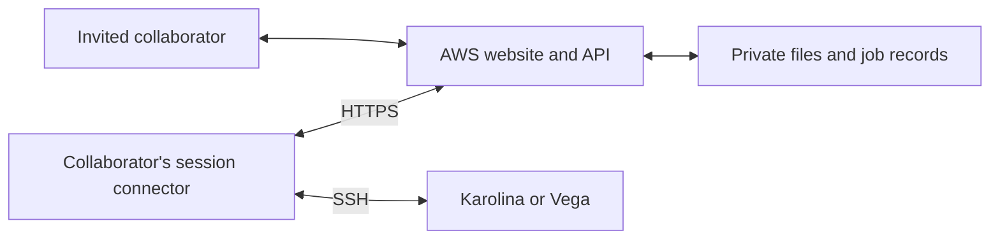

# AWS-MesoUQ

For SSH operation, first start the shared foreground controller described in [SSH connection control](docs/ssh-connection-control.md). The connector borrows that authenticated session and cannot silently open a replacement.


Publish private scientific workflows through AWS while calculations run under
each collaborator's own HPC account. The first workflow calibrates one
indentation curve with an approved MesoUQ model and preset.

This public repository contains application code, infrastructure definitions,
tests and deployment instructions. Scientific models, measurements, deployment
state, account configuration and real validation results remain private. A
working scientific installation of MesoUQ and institutional HPC access are
operator prerequisites; this repository does not include a standalone scientific
demonstration or claim that an AWS deployment has already been accepted.



## First release

- Invited accounts with MFA; protected website assets and research data.
- One CSV force/displacement curve with explicit units and nominal diameter
  3.2, 3.4 or 5.8 µm, limited to 1 MiB and 2–1,000 data points. The approved
  scientific preset is fixed; accepted curves are used without downsampling.
- Estimates and credible intervals for kA, kB and d0; a fitted displacement curve
  with uncertainty; conditional acoustic-resonance estimates.
- Posterior samples, numerical results, settings, provenance and PNG/PDF figures
  available to authorized project members.
- A macOS/Linux foreground connector uses the collaborator's own SSH identity,
  private recovery journal and site configuration. AWS holds no HPC SSH keys.
- Successful scientific results and archive receipts require an operator-enrolled
  connector device signature. Browser OAuth credentials cannot forge them.
- Compute on SCRATCH, then copy and verify retained files in a separate PROJECT
  archive. Only verified archives start the AWS retention clock.

Frequency intervals propagate kA variation conditional on the approved bank's
fixed kB. They do not propagate inferred kB uncertainty, surrogate approximation
error, physical-model discrepancy or diameter uncertainty. Unsupported resonance
inputs produce an unavailable result with a reason.

The first release defers population calibration, retraining, model promotion,
native Windows support and extraction of an independent scientific engine.
Both site interfaces are retained; live Vega validation is deferred.

## Benchmark Lab

The Benchmark Lab section compares analytical hierarchical TMCMC with seven
fresh HNPE factors per campaign. Users select a bounded noise/prior scenario
and method controls, then inspect matched-case accuracy, actual allocated
resources, training histories and verified posterior figures/downloads.
FastAPI in the existing Docker-packaged Lambda coordinates metadata; all real
scientific calculations run on Karolina through the enrolled connector.
See the [scientific and operating contract](docs/benchmark-lab.md). Live
deployment and owner acceptance are separate release gates.

## Repository layout

| Location | Responsibility |
| --- | --- |
| `apps/aws_publishing` | Browser interface and session handling |
| `services/aws_publishing` | Python Lambda API and storage adapters |
| `infra/aws_publishing` | Terraform infrastructure and security boundaries |
| `src/aws_mesouq` | Lightweight contracts, locked preset and connector |
| `src/aws_mesouq/adapters` | Thin adapter to the installed MesoUQ runtime |
| `schemas/aws_publishing` | Portable request and result schemas |

## Development

Install the lightweight package and service test dependencies in an isolated
Python 3.11+ environment. Neither package installs Torch or the HPC engine.

```sh
python -m pip install -e '.[test]' -e 'services/aws_publishing[test]' matplotlib
python -m pytest
npm --prefix apps/aws_publishing test
npm --prefix apps/aws_publishing run build
```

On Karolina, invoke `/usr/bin/python3.11` for connector and tooling commands;
scientific execution uses the separately verified operator runtime profile.
Public test fixtures are synthetic and are not scientific validation results.

The installed package includes the locked JSON preset and standalone scientific
adapter. It imports without the HPC scientific environment; cryptography is a
required dependency for local application-device signatures. Build a wheel with
`python -m pip wheel --no-deps . --wheel-dir .local/wheels` and check the export
with `python tools/check_public_export.py`. The scanner checks tracked and
unignored candidate files, including tracked files that would otherwise be
ignored; operator-specific private strings can be supplied from an ignored local
JSON array. It supplements the human review before publication.

See the [service](services/aws_publishing/README.md),
[infrastructure](infra/aws_publishing/README.md),
[browser](apps/aws_publishing/README.md) and
[connector](src/aws_mesouq/connector/README.md) instructions.
The [operator setup](docs/operator-setup.md) describes device-key enrollment,
adapter approval, separate compute/archive roots, and private acceptance gates.

## Operating limits

The target is five invited collaborators and ten active jobs. Slurm determines
actual execution availability. Files remain on AWS for at least thirty days after
their first verified archive receipt; database summaries are retained.

The AWS Free account plan is time/credit limited. Verify current account plan,
service eligibility and credit balance before deployment. Keep the approved
zero-out-of-pocket boundary, and export/shut down before access expires. Monitoring
budgets are alerts rather than hard spending caps. No deployment workflow silently
upgrades an account plan.

The software is derived from MesoUQ; see [NOTICE](NOTICE) and [LICENSE](LICENSE).
