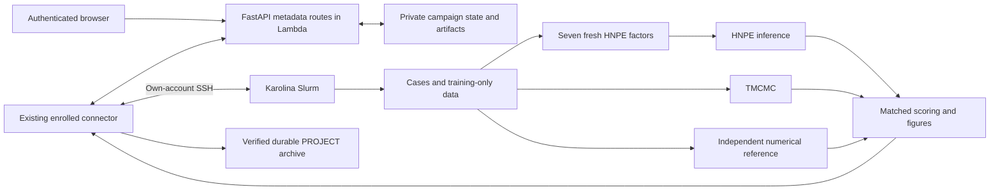

# Benchmark Lab

Benchmark Lab compares hierarchical TMCMC and freshly trained hierarchical
neural posterior estimation on the same analytical target and held-out cases.
It is a separate section of the existing private calibration application.
The first implementation supports fixed total method budgets. The planned
accuracy-target mode is a later project milestone and is not silently treated
as delivered by this release.

## Execution boundary

The browser submits metadata and displays verified results. FastAPI/Pydantic
routes run through Mangum in the existing Docker-packaged AWS Lambda. AWS stores
private campaign records and curated artifacts; it does not train models or
evaluate scientific likelihoods.

The foreground connector uses the collaborator's existing enrolled identity
and SSH account. All scientific stages run under native Slurm admission on
Karolina, using a separately verified MesoUQ source revision and environment.
No public service port, SSH key in AWS, compute-node Internet connection or
Docker daemon on Karolina is required. Native interfaces for the original
calibration workflow and Vega remain intact; this benchmark adapter currently
accepts the explicit Karolina scheduler profiles only.



## Scientific controls and interpretation

The analytical hierarchy has 21 parameters and 33 observations: three
mechanical curves and three acoustic scalar observations. The baseline target
remains fixed. Higher-noise scales the complete measurement-noise SD prior
distribution, including its truncation bounds. Broader physical priors jointly
scale population and conditional physical standard deviations, retaining means
and correlations; covariance therefore scales by the factor squared. Only the
selected scenario's slider is active. Scale one reproduces baseline.

The API capabilities describe all supported ranges and discrete controls. The
initial scale interval is 1–3 in steps of 0.25. Bounded neural subnet widths,
depths, learning rates, batch sizes and training limits are distinct from the
fixed flow architecture. TMCMC has separately validated population, covariance
and proposal settings. Unsupported values are rejected before execution.

Every campaign trains all seven factors anew: global, mechanical 1–3 and
acoustic 1–3. Training-only normalization and model selection are isolated from
final cases. Dependency receipts and embedded native checkpoint metadata bind
the campaign instance, source, request, target, factor, architecture, normalizer
and selected checkpoint role. A shape-compatible checkpoint from another
factor or campaign is not an acceptable substitute.

Reference generation is independent of both methods. Refinement checks include
independent scrambles, moments, evidence and deterministic marginal CDF probes.
An unresolved reference remains unresolved; it cannot qualify a method.
Finite-bank hierarchical TMCMC and these numerical stability checks do not
establish exact joint-posterior equality.

## Budgets, results and monitoring

The primary fixed budget is actual allocated GPU seconds per method. HNPE's
preparation, seven training/validation stages and inference count together.
TMCMC preparation and inference count together. Reference generation and
verification are reported separately. CPU core seconds, queue time and process
clocks are separate quantities. Slurm accounting supplies allocated resources;
missing accounting is unknown rather than zero.

The primary accuracy comparison uses the intersection of case IDs scored for
both methods against qualified references. Its denominator is explicit. Full
failure counts, unresolved cases and unpaired descriptive summaries remain
visible. Training histories, posterior overlays, allocation-cost figures and
genuine Float64 posterior bundles are retained. Good execution status does not
imply accuracy qualification or that HNPE outperforms TMCMC.

Native Slurm account, partition and QoS govern available resources. Per-method
experimental budgets and operator stage walltimes still apply. Unknown
submission acknowledgements are reconciled from durable markers instead of
blindly submitting again. Cancellation targets only the verified campaign's
jobs. Terminal scientific failures remain part of the comparison evidence.

Cloud storage admission reserves expected posterior bytes transactionally
against a shared project allowance. Curated files are bounded individually and
in total. Raw training data, native checkpoints and intermediate scientific
banks remain on Karolina. The durable archive retains all original files under
a complete checksum manifest; the cloud receipt binds its manifest and snapshot
rather than truncating the file list.

## Native aliases and archival recovery

The source inventory covers every retained private regular file and its exact
logical path. Native checkpoint hardlinks are accepted only when a fresh,
descriptor-checked inventory proves that every kernel alias is contained within
the owned source root. Symlinks, outside aliases, changed identity or metadata,
and incomplete proofs are rejected. Source aliases are never detached, renamed,
or chmodded by archival.

Each destination path is materialized as an independent read-only0400,
single-link file and reopened for checksum/size verification. Ephemeral source
inode proofs never enter cloud receipts, public manifests, or persisted journal
file inventories. Those retain their path/SHA256/size contract. Full PROJECT
archival includes all original files; the curated cloud-artifact quota does not
truncate this durable inventory.

Worker batches contain at most32 records and128MiB of logical data; an existing
larger file remains an explicitly isolated singleton. RPC metadata travels as
bounded JSON stdin, capped at4MiB. Source copy also verifies each installed file;
the worker separately verifies each completed batch before attestation.

A partial restart re-inventories fresh source proofs and checks the immutable
logical inventory. A completely verified PROJECT target can recover a lost
acknowledgement after SCRATCH has disappeared. Missing targets do not hide later
corruption: cached verification continues through missing targets and rejects
corrupt payloads before source inspection, staging, or payload writes. Verification
may create the archive token directory and its .archive.lock control file. A
recognized interrupted two-link installation passes checksum, size and stable
inode checks without changing either alias before recovery is allowed.
The existing archive event identity is reused; recovery never requires another
browser archival request.

## Operator setup and release

Existing calibration enrollment must already be complete. Never reset the
journal or generate another key merely to enable Benchmark Lab. Run the updated
connector package in a private environment and point it at that same journal.
The worker refuses absent or mismatched enrolled identities.

Private operator JSON supplies the scientific repository/revision, standalone
adapter SHA256, Python interpreter, environment script/SHA256, separate SCRATCH
run and PROJECT archive roots, exact account/host, scheduler profile,
reference/metrics walltimes and exact HTTPS upload origins. These are operator
inputs; browser requests cannot choose an executable, source revision or path.
Use the deployed project's trusted policy with the same source, adapter and
archive bindings. An operator-owned deployment mapping is a fallback only when
the project record has no explicit policy. It never grants membership.

The installed command is:

```sh
aws-mesouq-benchmark \
  --api-url "$APP_API_URL" --project "$APP_PROJECT" \
  --oauth-domain "$APP_OAUTH_DOMAIN" --client-id "$APP_CLIENT_ID" \
  --ssh-host "$APP_SSH_ALIAS" \
  --operator-config "$APP_OPERATOR_CONFIG" --journal "$APP_EXISTING_JOURNAL"
```

Complete OAuth/MFA privately. Check for an existing connector/listener before
starting another process. Observe the foreground process, retain its journal
for recovery and reconcile uncertain native/cloud outcomes before restarting.
The --once option performs one sweep and can claim work; it is not a harmless
authentication check when campaigns are pending.

Public source, CI fixtures and container recipes contain no real account
configuration, scientific results or credentials. Release checks must include
the portable API/worker suite, the actual scientific cross-contract suite on
Karolina, native checkpoint compatibility, real browser interactions, container
smoke and the independent review gates. Synthetic fixtures do not replace the
signed-in AWS → Karolina → browser acceptance campaign, exact downloads and
verified archive receipt.

See the [infrastructure instructions](../infra/aws_publishing/README.md) for the
scoped backend/static release workflows. Publish the verified immutable backend
image and configuration before exposing the new browser interface. Preserve the
current runtime configuration and unrelated website objects.
